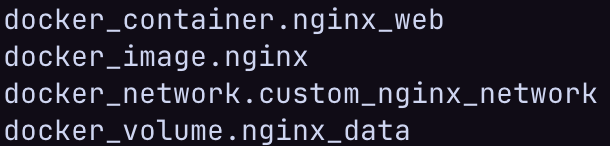
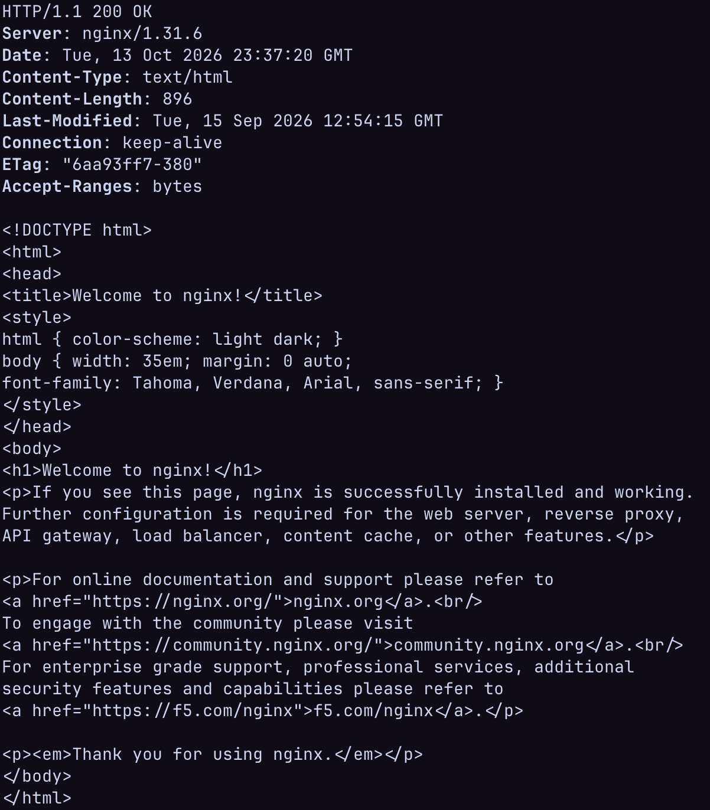
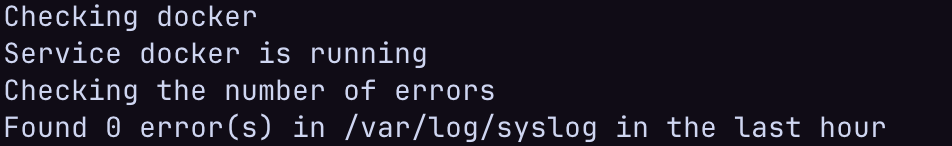
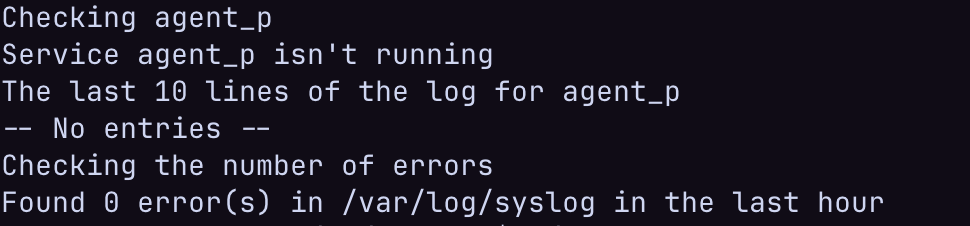
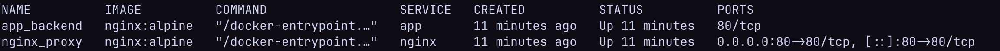

# STEP I: Ansible
1. **Create the inventory file**

&emsp; First of all, we need to create an inventory.ini (where all names of groups and servers belonging to those groups will be defined).

2. **Create the host_vars and .yaml files**

&emsp; Then we need to create a folder host_vars (and if you want, you can create another folder group_vars). In this folder you create files with .yaml extension, using the server names you specified in the .ini file.

---

### Examples:
—— **How the directory structure look right now**
```text
ansible/
├── inventory.ini
└── host_vars/
    └── example.yaml
```

—— **Example .ini and .yaml file in host_vars**

———**1. .ini file**
```ini
# ./ansible/inventory.ini
[wonderful_server]
fairy-server
```
———**2. .yaml file**
```yaml
# ./ansible/host_vars/fairy-server.yaml
---
ansible_host: 0.47.0.0
ansible_user: agent
ansible_ssh_private_key_file: /blood/money/contract
```

**3. Create the Ansible Playbook**

&emsp; We created a `setup_host.yaml` playbook that connects to the servers, creates a non-root `deployer` user with passwordless sudo access, and installs Docker along with the Docker Compose plugin.

—— Example setup_host.yaml file

```yaml
---
- name: Host Configuration
  hosts: web_servers
  become: yes
  vars: 
    ansible_python_interpreter: /usr/bin/python3  

  tasks:
    - name: Create deployer user
      user:
        name: deployer
        state: present
        shell: /bin/bash
        create_home: yes
    - name: Deployer has sudo?
      lineinfile:
        dest: /etc/sudoers
        regexp: '^deployer'
        line: 'deployer ALL=(ALL) NOPASSWD: ALL'
        validate: 'visudo -cf %s'
    - name: Update apt and install all Docker dependencies
      apt:
        name:
          - curl
          - ca-certificates
          - software-properties-common
          - apt-transport-https
        state: present
        update_cache: yes
    - name: Create directory for Docker GPG key
      file:
        path: /etc/apt/keyrings
        state: directory
        mode: '0755'
    - name: Download Docker GPG key
      get_url:
        url: https://download.docker.com/linux/ubuntu/gpg
        dest: /etc/apt/keyrings/docker.asc
        mode: '0644'
    - name: Docker installation path
      deb822_repository:
        name: docker
        types: [deb]
        architectures: [amd64]
        uris: "https://download.docker.com/linux/ubuntu"
        suites: ["{{ ansible_facts['distribution_release'] }}"]
        components: [stable]
        signed_by: /etc/apt/keyrings/docker.asc
        state: present
    - name: Install Docker Engine and Docker Compose
      apt:
        name: 
          - docker-ce
          - docker-ce-cli
          - containerd.io
          - docker-compose-plugin
        state: present
        update_cache: yes
    - name: Add deployer to docker group
      user:
        name: deployer
        groups: docker
        append: yes
    - name: Docker autostart
      service:
        name: docker
        state: started
        enabled: yes
```

**4. How to run**

&emsp; To prepare the server, run the following command from the `ansible/` directory:
```bash
ansible-playbook -i inventory.ini setup_host.yaml
```

**5. Idempotency Check**

&emsp; Next, we need to check idempotency. If we run the playbook a second time, it will not change anything on the server. You can see the result on the screenshot below.


---

## STEP II: Terraform

**1. Create the Terraform directory**

&emsp; First of all, we need to create a separate folder for our Terraform project (for example, `terraform/`).

**2. Create the main.tf file**

&emsp; Then we need to create a `main.tf` file in this folder. In this file, we configure the Docker provider, download the Nginx image, and create a custom network, a volume, and the container itself (running on a non-standard port 6767).

---

### Examples:
—— **How the directory structure looks right now**

```text
terraform/
└── main.tf
```

—— Example main.tf file

```tf
# ./terraform/main.tf
terraform {
  required_providers {
    docker = {
      source  = "kreuzwerker/docker"
      version = "~> 3.0.0"
    }
  }
}
provider "docker" {
  host = "unix:///var/run/docker.sock"
}
resource "docker_image" "nginx" {
  name         = "nginx:latest"
  keep_locally = false
}
resource "docker_network" "custom_nginx_network" {
  name = "nginx_net"
}
resource "docker_volume" "nginx_data" {
  name = "nginx_volume"
}
resource "docker_container" "nginx_web" {
  name  = "nginx_terraform"
  image = docker_image.nginx.image_id

  networks_advanced {
    name = docker_network.custom_nginx_network.name
  }

  volumes {
    volume_name    = docker_volume.nginx_data.name
    container_path = "/usr/share/nginx/html"
  }

  ports {
    internal = 80
    external = 6767
  }
}
```

**3. How to run**

&emsp; To deploy the container and all resources, run the following commands from the `terraform/` directory one by one:

```bash
terraform init
terraform plan
terraform apply -auto-approve
```

**4. Verification Check**

&emsp; Next, we need to check if everything works correctly. First, we use the `terraform state list` command to see all created objects. Then, we check if Nginx answers on our custom port using `curl -i http://localhost:6767`. You can see both results on the screenshots below.

**Terraform State:**  


**Nginx HTTP Response:**  


---

## STEP III: Bash Monitoring Script

**1. Create the script file**

&emsp; First of all, we need to create a `monitor.sh` file on our VM.

**2. Write the monitoring logic**

&emsp; In this file, we write a Bash script that takes a service name as an argument. It checks if the service is active using `systemctl`. If the service is not running, the script shows the last 10 lines of its logs using `journalctl`. After that, it counts the number of errors in `/var/log/syslog` for the last hour using `grep` and `awk`.

---

### Examples:
—— **How the directory structure looks right now**

```text
scripts/
└── monitor.sh
```

—— **Example monitor.sh file**

```bash
#!/bin/bash

if [ -z "$1" ]; then
    echo "Usage: ./monitor.sh <service_name>"
    exit
fi

SERVICE=$1

echo "Checking $SERVICE"

STATE=$(systemctl is-active "$SERVICE")

if [ "$STATE" = "active" ]; then
    echo "Service $SERVICE is running"
else
    echo "Service $SERVICE isn't running"
    echo "The last 10 lines of the log for $SERVICE"
    journalctl -u "$SERVICE" -n 10 --no-pager
fi

echo "Checking the number of errors"

if [ -f /var/log/syslog ]; then
    TIME_HOUR_AGO=$(date -d "-1 hour" '+%Y-%m-%dT%H:%M:%S')
    ERRORS=$(grep -i "error" /var/log/syslog | awk -v iso="$TIME_HOUR_AGO" '$1 >= iso {count++} END {print count+0}')
    echo "Found $ERRORS error(s) in /var/log/syslog in the last hour"
else
    echo "Couldn't find file /var/log/syslog"
fi
```

**3. How to run**

&emsp; First, we need to make the script executable, and then we can run it by passing any service name as an argument:

```bash
chmod +x monitor.sh
./monitor.sh docker
./monitor.sh agent_p
```

**4. Verification Check**

&emsp; Next, we need to check if our script works correctly in both situations. First, we test it with a running service (`docker`), and then we test it with a non-existing service (`agent_p`) to see the log output. You can see both results on the screenshots below.

**Active Service Check (docker):**


**Inactive Service Check (agent_p):**  


---

## STEP IV: Docker Compose Environment

**1. Create the application directory and config files**

&emsp; First of all, we need to create the `/opt/app` folder on our VM. Inside this folder, we create an `html/index.html` file with our custom text for the backend container, and a `rev_proxy.conf` file to configure Nginx as a reverse proxy.

**2. Create the docker-compose.yml file**

&emsp; Then we create a `docker-compose.yml` file with two services (`app` and `nginx`) connected to a custom bridge network (`compose_net`). Only the `nginx` reverse proxy exposes port `80` to the host, while the `app` backend service stays isolated inside the internal Docker network.

---

### Examples:
—— **How the directory structure looks right now**

```text
/opt/app/
├── docker-compose.yml
├── rev_proxy.conf
└── html/
  └── index.html
```

—— **Example configuration files**

——— **1. html/index.html**

```html
<html lang="en">
<head>
    <meta charset="UTF-8">
    <title>Chill</title>
</head>
<body>
        <h1>Hello, world!</h1>
</body>
</html>

```

——— **2. rev_proxy.conf**

```nginx
server {
    listen 80;

    location / {
        proxy_pass http://app:80;
        proxy_set_header Host $host;
        proxy_set_header X-Real-IP $remote_addr;
    }
}
```

——— **3. docker-compose.yml**

```yaml
services:
  app:
    image: nginx:alpine
    container_name: app_backend
    volumes:
      - ./html/index.html:/usr/share/nginx/html/index.html:ro
    networks:
      - compose_net

  nginx:
    image: nginx:alpine
    container_name: nginx_proxy
    ports:
      - "80:80"
    volumes:
      - ./rev_proxy.conf:/etc/nginx/conf.d/default.conf:ro
    depends_on:
      - app
    networks:
      - compose_net

networks:
  compose_net:
    driver: bridge
```

**3. How to run**

&emsp; To start the environment in the background, run the following command from the `/opt/app` directory:

```bash
docker compose up -d
```

**4. Verification Check**

&emsp; Next, we need to check if both containers are running and if the reverse proxy successfully forwards requests to the backend app. First, we run `docker compose ps` to check the status. Then, we run `curl http://localhost` to see our "Hello, world!" response. You can see both results on the screenshots below.

**Docker Compose Status:**


**Reverse Proxy Curl Response:**  
