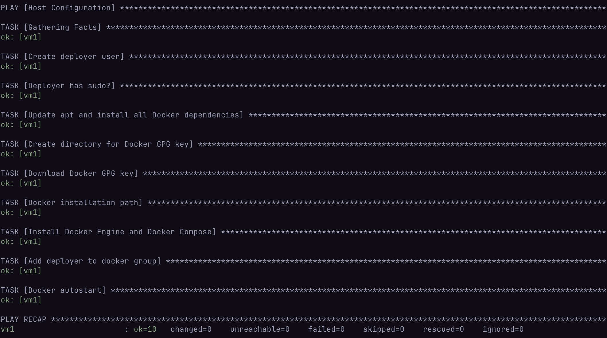

# STEP I
1. **Create the inventory file**
&emsp; First of all, we need to create an inventory.ini (where all names of groups and servers belonging to those groups will be defined).
2. **Create the host_vars and .yaml files**
&emsp; Then we need to create a folder host_vars (and if you want, you can create another folder group_vars). In this folder you create files with .yaml extension, using the server names you specified in the .ini file.

---

### Examples:
—— **How the directory structure look right now**
```text
ansible/
├── inventory.ini
└── host_vars/
    └── example.yaml
```

—— **Example .ini and .yaml file in host_vars**

———**1. .ini file**
```ini
# ./ansible/inventory.ini
[wonderful_server]
fairy-server
```
———**2. .yaml file**
```yaml
# ./ansible/host_vars/fairy-server.yaml
---
ansible_host: 0.47.0.0
ansible_user: agent
ansible_ssh_private_key_file: /blood/money/contract
```

**3. Create the Ansible Playbook**

&emsp; We created a `setup_host.yaml` playbook that connects to the servers, creates a non-root `deployer` user with passwordless sudo access, and installs Docker along with the Docker Compose plugin.

**4. How to run**

&emsp; To prepare the server, run the following command from the `ansible/` directory:
```bash
ansible-playbook -i inventory.ini setup_host.yaml
```

**5. Idempotency Check**

&emsp; Next, we need to check idempotency. If we run the playbook a second time, it will not change anything on the server. You can see the result on the screenshot below.

